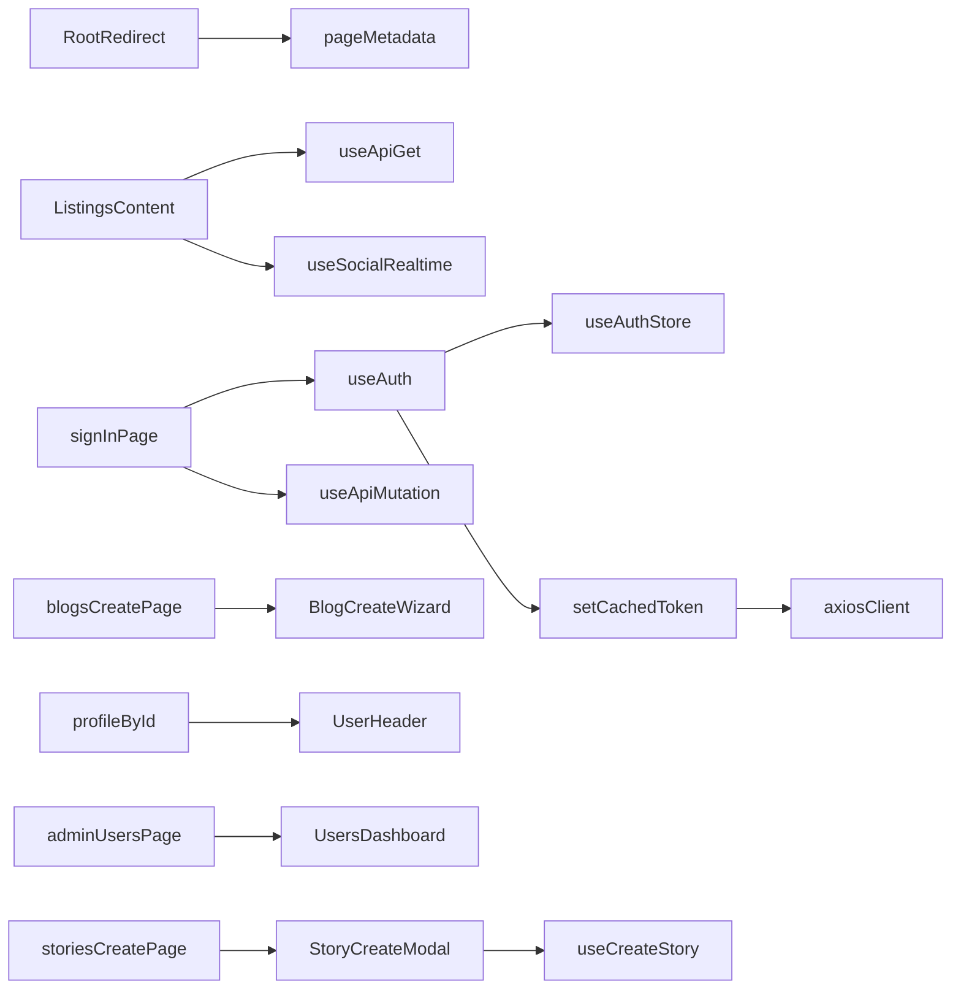

# Frontend feature graph

Before editing a feature, call `codegraph_explore` with `projectPath` `D:\MarketPlace\MarketPlace-Next-JS` and the prompt seed for that feature.

Edges below come from Codegraph route nodes, `codegraph_explore`, and `codegraph callers`. `opencode/gpt-5.5` returned insufficient funds. `opencode/nemotron-3-ultra-free` queried the index and did not write this file.

Shared clients, confirmed by explore:

- `useAuth` in `src/lib/use-auth.ts` reads `useAuthStore` (`src/store/auth.store.ts`) and calls `setCachedToken` in `src/lib/axiosClient.ts`
- `axiosClient` reads `useAuthStore` and unwraps the API envelope in `api`
- `useApiGet` and `useApiMutation` live in `src/lib/api-hooks.ts`

## Home

- Route: `/` → `src/app/page.tsx` `RootRedirect`
- Call path: `RootRedirect` → `pageMetadata`; redirects to `/blog` or `/listings` from host headers
- Prompt seed: Explore RootRedirect pageMetadata before editing the home redirect.

## Listings

- Route: `/listings` → `src/app/listings/page.tsx` `ListingsPage` / `ListingsContent`
- Call path: `ListingsContent` → `useApiGet` `["listings","all"]` `/listings`, `useSocialRealtime`, `useLanguage`
- Layout `src/app/listings/layout.tsx` → `pageMetadata`
- Prompt seed: Explore ListingsContent useApiGet useSocialRealtime before editing the listings grid.

## Listing detail

- Route: `/listings/:id` → `src/app/listings/[id]/page.tsx`
- Call path: that page calls `useApiGet`, `useApiMutation`, and `useAuth`. Symbols on the page include `ListingDetailsContent` and `FeedbackCreateForm`
- Layout `src/app/listings/[id]/layout.tsx` → `pageMetadata`
- Prompt seed: Explore ListingDetailsContent useApiGet useApiMutation useAuth before editing a listing page.

## Listing create

- Route: `/listings/create` → `src/app/listings/create/page.tsx`
- Call path: page → `useApiGet`, `useApiMutation`, `useListingsStore`
- Layout → `pageMetadata`
- Prompt seed: Explore listings create useApiMutation useListingsStore before editing listing create.

## Blogs

- Routes: `/blogs` → `src/app/blogs/page.tsx`; `/blogs/:id` → `src/app/blogs/[id]/page.tsx`; `/blogs/create` → `src/app/blogs/create/page.tsx`
- Also present: `/blog` → `src/app/blog/page.tsx` and `/blog/:id` → `src/app/blog/[id]/page.tsx`
- Confirmed: `src/app/blogs/create/page.tsx` → `BlogCreateWizard`; `src/app/blogs/[id]/page.tsx` → `useApiMutation` (`BlogDetailPage`, `SocialBar` are symbols on that file)
- Layouts under `src/app/blogs/` call `pageMetadata`
- Which component `/blog` renders is not in the caller list (`BlogViewer` has no callers)
- Prompt seed: Explore BlogCreateWizard BlogDetailPage useApiMutation before editing blogs.

## About

- Route: `/about` → `src/app/about/page.tsx` `AboutPage` → `pageMetadata`
- Prompt seed: Explore AboutPage pageMetadata before editing the about page.

## Contact

- Route: `/contact` → `src/app/contact/page.tsx` `ContactPage` → `pageMetadata`
- Prompt seed: Explore ContactPage pageMetadata before editing contact.

## Sign in

- Route: `/sign-in` → `src/app/sign-in/page.tsx`
- Call path: page → `useAuth`, `useAuthStore`, `setCachedToken`, `useApiMutation`, `useNotificationsStore`, `useListingsStore`, `SocialAuthButtons`; then `router.replace("/listings")`
- Layout → `pageMetadata`
- Prompt seed: Explore sign-in useAuth useApiMutation setCachedToken useAuthStore before editing login.

## Sign up

- Route: `/sign-up` → `src/app/sign-up/page.tsx`
- Call path: page → `useApiMutation`, `SocialAuthButtons`, `useLanguage`
- Layout → `pageMetadata`
- Prompt seed: Explore sign-up useApiMutation SocialAuthButtons before editing registration.

## Profile

- Route: `/profile` → `src/app/profile/page.tsx` (layout calls `pageMetadata`)
- Route: `/profile/:id` → `src/app/profile/[id]/page.tsx` → `UserHeader`
- Inner symbols of `/profile` itself are not in the caller list
- Prompt seed: Explore UserHeader useAuth before editing a public profile.

## My listings

- Route: `/my-listings` → `src/app/my-listings/page.tsx` `MyListingsPage`
- Call path: page → `useApiMutation`, `useListingsStore`, `useLanguage`
- Prompt seed: Explore MyListingsPage useApiMutation useListingsStore before editing my listings.

## Pendings

- Route: `/pendings` → `src/app/pendings/page.tsx`
- Call path: page → `usePendingListings`, `useApiMutation`, `useLanguage`
- Prompt seed: Explore usePendingListings useApiMutation before editing the pending queue.

## Settings

- Route: `/settings` → `src/app/settings/page.tsx` `SettingsPage` → `useLanguage`
- Route: `/settings/appearance` → `src/app/settings/appearance/page.tsx` → `AppearanceSettings`
- Route: `/settings/themes` → `src/app/settings/themes/page.tsx`
- `ThemeProvider` callers are `src/app/layout.tsx`, `src/components/providers/theme-provider.tsx`, and `src/lib/repo/theme.tsx`. A themes-page → `ThemeProvider` edge is not in the graph
- Prompt seed: Explore SettingsPage AppearanceSettings ThemeProvider before editing appearance.

## Admin

- `/admin` → `src/app/admin/page.tsx` → `useApiGet`. Layout → `pageMetadata`
- `/admin/users` → `UsersDashboard` (`src/components/users/users-dashboard.tsx`), and that file calls `useApiGet`
- `/admin/categories` → `useCategoryData` is used by `CategoriesTable`, `CategoryCreateWizard`, `CategoryRow`, and `ParentAutocomplete`. The page file → those components edge is not in the caller list
- `/admin/ads` → `useApiGet` and `useApiMutation`
- `/admin/stories` → `useStories` and `useAuth`
- `/admin/stories/create` → `StoryCreateModal` → `useCreateStory`
- `/admin/notifications` → `useApiGet` and `useApiMutation`
- `/admin/contacts` route file is `src/app/admin/contacts/page.tsx`. Inner symbols are not in the caller list
- `/admin/manage-content-status` → `useApiGet`, `useApiMutation`, `useAuth`
- Prompt seed: Explore UsersDashboard useStories StoryCreateModal useApiGet useAuth before editing an admin screen.

## Confirmed flow

## Unconfirmed

- `BlogViewer` has no callers. Do not treat it as the `/blog` page until Codegraph shows that edge.
- `/admin/contacts` and `/settings/themes` are route nodes only.
- `/admin/categories/page.tsx` is a route node. `useCategoryData` callers are category components, not that page file.
- `use-auth.ts` comments mention SWR. The hook that is actually called is `useLocalGetImmutable` from `src/lib/api-hooks.ts`.
